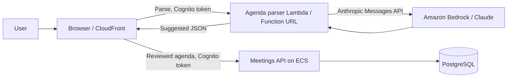

# ADR 0006: Parse pasted agendas beside the main API

Status: accepted; deployed and verified on 2026-10-21.

## Context

Users receive agenda text in chat and email, in several languages, with incomplete dates and owners. A parser can suggest fields but must not invent a decision or change meeting data. The application has no NAT gateway, and an idle VPC endpoint adds fixed monthly cost. Pasted text is untrusted and each model call has a cost. The deployed site uses Cognito, an ECS/FastAPI API and PostgreSQL; the parser can work without database access.

## Decision

Use Claude Haiku 4.5 through Amazon Bedrock Runtime's Anthropic Messages API by default, configured through `PARSER_MODEL`. Bedrock Mantle rejected the 5.5 models in this account; the one-time Anthropic use-case form was submitted and Haiku 4.5 works. This transport change retains Claude and the Messages/tool-call contract; compare Haiku with Opus only if Opus later becomes available. A separate Lambda outside the VPC accepts at most 10,000 characters through a Function URL after verifying a Cognito access token. It asks Claude for one tool call, validates the result against a strict Pydantic schema, and retries invalid output once. It returns a suggestion only. The browser shows every field for review; its Save action uses the existing authenticated meetings API on ECS. The API stores both the final agenda and the original suggestion, model and prompt version in PostgreSQL.

The function logs the model, prompt version, token counts, elapsed time, an estimated dollar cost, and Cognito user ID. It does not log pasted text. A $5 monthly account budget sends an email at 80% of the limit; a budget is an alert, not a spending cap. Actual AWS billing is the source of truth for cost.

## Alternatives

- Call Bedrock from the main API through a VPC endpoint: a sound option if the parser needed private data, but this one does not, and an endpoint would add idle cost.
- Call Anthropic directly: requires a separate API key and billing path; Bedrock uses the existing AWS identity and cost controls.
- Use only regular expressions: cheap and deterministic, but fragile for multilingual, loosely formatted messages and relative dates.

## Consequences

Model output can be wrong, so it is never saved automatically. The five-input evaluation records errors and invented values. If Bedrock is unavailable or throttled, the user can type the agenda manually and the rest of the meetings app still works. The estimate in logs may differ from billed charges or future prices. The Lambda has no VPC or database permissions. AWS currently has no Aurora cluster for this project; the `infra/backend.yml` Aurora design exists in source but is not deployed. The save path therefore uses the existing PostgreSQL backend and does not claim Aurora merely because the lab diagram names it.

## Container flow

