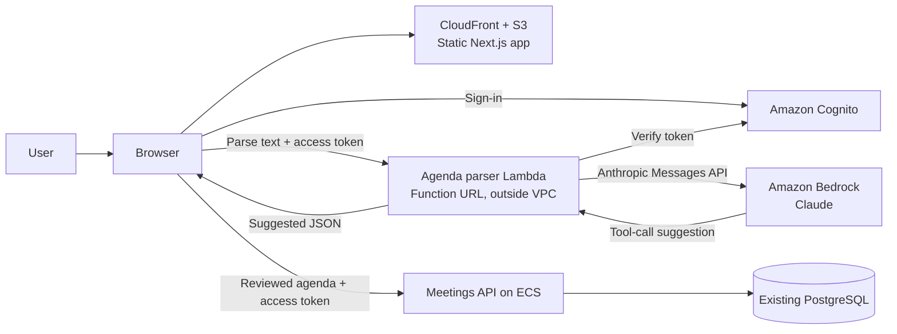

# SuccessfulSuccess containers — Lab 6

This diagram reflects the resources verified in the AWS account on 2026-10-21: the site is on CloudFront/S3, Cognito handles sign-in, the meetings API runs on ECS, and the agenda parser runs on Lambda outside the VPC. The parser was tested through the deployed site. The existing meetings API uses PostgreSQL; there is no Aurora cluster in this account.

The parser has no database access. Only the existing API writes a reviewed agenda and stores the model's original suggestion for later quality evaluation. The `infra/backend.yml` Aurora design is present in source but is not deployed in this AWS account, so the diagram does not represent it as live infrastructure.
